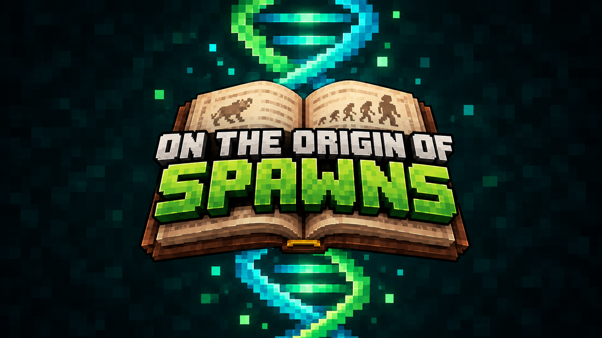

### Adapt or go extinct

_A Fabric mod where the mobs evolve from how you kill them_

  <a href="#overview"><b>Overview</b></a> |
  <a href="#features"><b>Features</b></a> |
  <a href="#build"><b>Build</b></a> |
  <a href="#release"><b>Release</b></a> |
  <a href="DESIGN.md"><b>Design</b></a> |
  <a href="ROADMAP.md"><b>Roadmap</b></a>

---

> [!NOTE]
> **The mod is in development.** There is no release yet. The project
> builds, but it has no gameplay.
> [ROADMAP.md](ROADMAP.md) lists the milestones of the first release.
> [DESIGN.md](DESIGN.md) holds each decision of the design.

---

## Overview

**On the Origin of Spawns** makes the mobs in your world evolve. Each mob
that you kill changes the next generation. Burn many zombies, and their
offspring start to resist fire. Outrun them, and their offspring get faster.

You evolve too, but you choose how. Select small adaptations, each with a
trade-off. Then watch the mobs adapt to counter you. Record each species in
your Beagle Notebook while natural selection and artificial selection race
each other.

## Features

These features are for the first release. Some are not complete.

- A gene pool for each species in each biome category: hot, cold, wet,
  temperate, nether, and end
- The cause of each death changes the pool: fire, arrows, melee, explosions,
  falls, and zombies that die before they reach you
- Genes that change how mobs look, fight, sense, and spawn
- A downside for each gene, and a maximum of 5 genes for each mob
- 5 major families and 20 minor families for each species, with hybrids
- Extinction of a species in a biome category
- 30 player perks, each with a gain and a cost
- 1 to 5 perk slots, from the knowledge percentage of your notebook
- The Beagle Notebook, with charts, family trees, and predictions
- The Royal Society block and the Naturalist villager, to share notebook
  pages for XP
- Gene pools that all players in a world share
- Genes, perks, and pressures in data packs

## Build

You need Java 21 or later to start Gradle. Gradle runs the build on Java 25,
and downloads Java 25 if it is not on the computer.

| Command | Result |
| ------- | ------ |
| `./gradlew build` | The mod file in `build/libs/` |
| `./gradlew runClient` | Starts Minecraft with the mod |
| `./gradlew runServer` | Starts a server with the mod |

## Release

1. Set `mod_version` in `gradle.properties`.
2. Commit the change.
3. Publish a GitHub release with the tag `v` and the version, for example
   `v0.1.0`. The text of the release becomes the changelog.

The `release` workflow then builds the mod. It uploads the mod file to
Modrinth, CurseForge, and the GitHub release. The workflow uses the
`MODRINTH_TOKEN` and `CURSEFORGE_TOKEN` repository secrets.

## Support

If you like On the Origin of Spawns, you can support its development here.

## Licence

All rights reserved. See [LICENSE](LICENSE) for what you can do with this
work. This is not an official Minecraft product. Mojang and Microsoft do not
approve it, and it has no connection with them.
